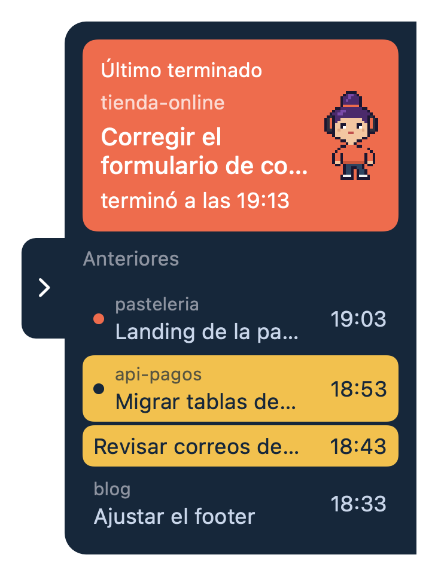

# Personita Mac

Una barra flotante pegada al borde derecho de la pantalla que muestra qué sesiones de Claude Code terminaron o están esperando una respuesta tuya. Está pensada para quien trabaja con varias sesiones a la vez en la app de escritorio de Claude y pierde el hilo de cuál terminó primero.



Arriba va un cuadro con la última sesión y una personita de pixel art que se mueve; abajo, las anteriores. Un clic en cualquiera la abre en la app de Claude.

## Qué significa cada color

- **Naranja**: la sesión terminó y todavía no la has abierto.
- **Amarillo**: Claude te está esperando, porque pidió un permiso o te hizo una pregunta.
- **Un punto en la fila**: sesión sin ver. Es naranja si terminó y azul si te está esperando.
- **Sin color de fondo**: ya la viste o no hay nada pendiente.

De cada sesión se muestra el título y, en letra chica, la carpeta del proyecto. Si el nombre se corta, déjale el mouse encima y aparece completo al costado.

La barra se puede esconder y queda solo una flecha en el borde. Se esconde sola cuando sacas el mouse (salvo que hayas hecho clic en una sesión, caso en que se queda abierta hasta que aprietes la flecha) y se abre sola cuando llega un aviso nuevo. Clic derecho sobre la barra para salir.

## Requisitos

- Mac con chip Apple (M1 o posterior)
- macOS 13 o superior
- Command Line Tools de Xcode (`xcode-select --install`)
- Claude Code
- la app de escritorio de Claude

## Instalación

```zsh
git clone https://github.com/Thealvarro/personita-mac.git
cd personita-mac
./instalar.sh
```

El instalador compila la app en tu Mac (no se distribuye ningún binario), la deja en `~/Applications/Personita.app`, copia el script del hook a `~/.claude/personita-mac/aviso-mac.py` y agrega sus hooks a `~/.claude/settings.json`. Antes de tocar ese archivo hace un respaldo, `settings.json.respaldo-personita-<fecha>`, y no modifica los hooks que ya tengas.

La app no tiene ícono en el Dock ni en la barra de menú. Si ya hay una abierta, la segunda se cierra sola.

## Desinstalación

```zsh
./desinstalar.sh
```

Quita la app, el script y los hooks que agregó el instalador.

## Cómo funciona

Los hooks de Claude Code llaman a `aviso-mac.py`, que anota cada evento en `~/.claude/personita-mac/avisos.jsonl` (carpeta con permiso 700, archivo con 600, máximo 200 líneas). La app lee ese archivo cada segundo. Cada línea trae un tipo: `termino` (terminó), `espera` (pidió permiso o terminó con una pregunta) o `respondio` (ya le contestaste, y el amarillo se apaga).

Para los títulos, la carpeta y saber qué sesiones no has leído, la app lee dos cosas que son internas de la app de escritorio de Claude, siempre en solo lectura:

- los archivos `local_*.json` de `~/Library/Application Support/Claude/claude-code-sessions/`, de donde saca el título, la carpeta y cuándo la abriste por última vez
- el Local Storage de esa app (`~/Library/Application Support/Claude/Local Storage/leveldb/`), de donde saca la lista de sesiones sin leer

Para abrir una sesión usa un enlace `claude://` que Anthropic no documenta.

## Privacidad y seguridad

Qué lee: el archivo de avisos y los dos lugares de la app de Claude que se listan arriba. Qué escribe: solo `~/.claude/personita-mac/avisos.jsonl` (lo hace el script del hook) y la preferencia de si la barra está escondida, que guarda en las preferencias de la propia app. No modifica nada de la app de Claude.

La app no se conecta a internet, no tiene telemetría ni analítica. Los textos que lee de archivos ajenos se limpian y se acotan antes de mostrarlos, y nada de lo que lee se usa para armar comandos.

**Función del iPad (opcional, apagada por defecto).** Existe para un iPad compañero que muestra la misma lista. Solo se activa si existen `~/.claude/personita-ipad-clave` y `~/.claude/personita-mac/ipad`. Cuando está activa:

- el Mac le envía la lista (títulos de sesión y carpetas incluidos) por HTTP sin cifrar, con una clave en una cabecera
- el Mac escucha en el puerto 8081 una única orden, `POST /abrir`, que solo puede abrir una sesión que ya está en la lista
- la clave se compara en tiempo constante, hay un límite de 20 peticiones por minuto y las peticiones se leen con un tope de 2048 bytes

Como no hay cifrado, cualquiera en tu red puede ver la lista y la clave. No la actives en redes públicas ni compartidas. La app del iPad no forma parte de este repositorio.

El único enlace web que hay en el proyecto es el crédito del autor, en el menú contextual.

## Limitaciones

- Depende de detalles internos y no documentados de la app de escritorio de Claude (el formato de sus archivos de sesión, su Local Storage y el enlace `claude://`). Una actualización de esa app puede romperlo.
- Solo funciona en macOS, y por ahora solo se compila para Mac con chip Apple. En un Mac Intel el instalador se detiene y avisa.
- Si no usas la app de escritorio de Claude, no hay títulos y el clic en una sesión no la abre: solo abre la app, si está instalada en `/Applications`.
- Las lecturas del Local Storage son una interpretación propia del formato LevelDB. Si no se pueden hacer, la marca de sin ver cae a una heurística basada en cuándo abriste cada sesión.

## Compilar y correr las pruebas

```zsh
./construir.sh        # deja build/Personita.app firmada ad-hoc
./Pruebas/probar.sh   # pruebas de lógica en una carpeta temporal
```

Para probar sin tocar tus avisos reales, la variable de entorno `PERSONITA_AVISOS` cambia la ruta del archivo de avisos. Más detalle en `CONTRIBUTING.md`.

## Licencia y créditos

GPL-3.0-or-later, con un término adicional sobre los créditos que está en `NOTICE`. El texto de la licencia está en `LICENSE`. La personita también es parte del proyecto y va bajo la misma licencia.

Desarrollado por [SICS](https://alvarocofre.dev).

Este es un proyecto independiente. No es un producto oficial de Anthropic, ni tiene su respaldo ni afiliación. "Claude" y "Claude Code" son marcas de Anthropic.

## English

Personita Mac is a small floating bar docked to the right edge of the screen that shows which Claude Code sessions have finished or are waiting for you. It is meant for people running several sessions at once in the Claude desktop app. Clicking a session opens it in that app.

Requirements: an Apple silicon Mac, macOS 13 or later, Xcode Command Line Tools, Claude Code and the Claude desktop app. It relies on undocumented internals of the desktop app, so an update from Anthropic may break it.

Install: `git clone https://github.com/Thealvarro/personita-mac.git`, `cd personita-mac`, `./instalar.sh`. The installer builds the app on your Mac, puts it in `~/Applications/Personita.app` and adds its hooks to `~/.claude/settings.json` after making a backup. Use `./desinstalar.sh` to remove it. The app never connects to the internet; an optional, off-by-default feature talks to a companion iPad over the local network. Not an official Anthropic product. The interface and docs are in Spanish.
